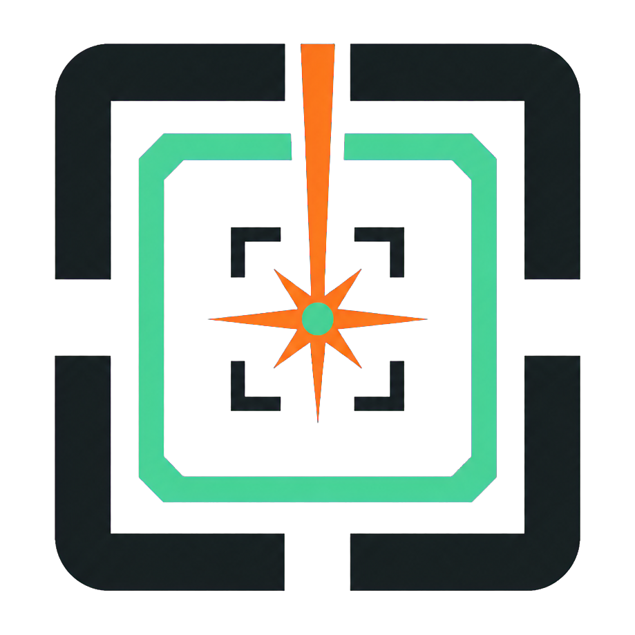

# Lalikul Cut Prep

<p align="center">
  
</p>

A local Windows demo that converts an image of a laser cutter bed into motif centres and cut squares or rectangles that can be exported as SVG.

The [cutting rules](docs/CUTTING_RULES.md) define section ownership, exact automatic
centres, cut-state colours, off-bed omissions and SVG acceptance checks.

The current version is **0.14.5**. Colour-based detection checks for
blank cloth beyond the outer printed row. See [alignment checks and current limits](docs/ALIGNMENT_CHECKS.md)
before comparing a camera image with a physical machine job.

The earlier **0.13.4** release's source identity, comparisons and
validation limits remain in the [version report](docs/RELEASE_0_13_4.md).

The initial configuration uses an **Epilog Fusion Maker 36**, a **36 x 24 in** bed, and a global cut size of **5 x 5 in**. You can also create custom machine profiles, change working units, and adjust the cut size.

> **Project status:** functional validation prototype. It does not control the laser cutter, start cutting jobs, or configure power, speed, frequency, focus, or materials.

## Documentation for users and developers

The documentation is split so that non-technical users do not have to read development details:

- This `README.md` explains what the app does, how to install it, and how to use it. It is also the project homepage on GitHub.
- The complete user manual is available in both languages:
  - [English user manual](docs/Lalikul_Cut_Prep_User_Manual_EN.docx)
  - [Spanish user manual](docs/Lalikul_Cut_Prep_Manual_de_usuario_ES.docx)
  Both editions include detailed instructions, screenshots, states, settings,
  navigation controls, automatic overlap correction, and troubleshooting guidance.
  Their screenshots and state descriptions predate 0.13.4; use the colour guide
  below and the current cutting rules for current behaviour.
- The [developer guide](docs/DEVELOPER_GUIDE.md) describes the architecture, virtual environment, tests, and technical decisions.
- [CHANGELOG.md](CHANGELOG.md) lists the behavior included in each shared update.
- The [0.13.4 validation](docs/RELEASE_0_13_4.md) and
  [performance report](docs/PERFORMANCE_0_13_4.md) record the current checks and
  their limits. Original customer photos and detailed QA captures stay private.

## Quick start for Windows users

[Instrucciones de actualización en español](docs/ACTUALIZACION_2026-10-14.md).

**Known limitation:** black/dark-background detection remains unreliable for
some collections despite passing specific regression examples. It is not
considered universally resolved. Review each result before export.

### 1. Download and extract

On GitHub, select **Code -> Download ZIP**. Extract the entire ZIP to a new,
short folder such as **Desktop\Lalikul** before continuing. Do not run the
application from inside the ZIP file. Setup detects overly long folder paths
and asks you to move the extracted folder before installing packages.

### 2. Install Python

Install [Python for Windows](https://www.python.org/downloads/windows/) 3.12
(64-bit, recommended). The pinned GUI dependencies support Python 3.10–3.14.
During installation, enable **Add python.exe to PATH**.
Python 3.12, 64-bit, is the Windows version used for this update's clean-install check.

### 3. Set up the application once

Double-click `setup.bat` and wait for the `Setup complete` message.

The setup script creates `.venv`, a private Python environment for this application, and installs PySide6, OpenCV, and NumPy. It does not install Node.js or create a web server.
Only the PySide6 Essentials components used by the application are installed;
unused Qt Addons are excluded to reduce downloads.
Setup also checks package compatibility, application imports and required bundled
images before reporting success. Internet access is needed to install packages.

### 4. Open the app without a terminal

Double-click **`Lalikul Cut Prep.lnk`**, which `setup.bat` creates automatically in the main folder.

This is the recommended launcher. It displays the Lalikul Cut Prep icon and opens the interface through `pythonw.exe`, without leaving a terminal window visible or using Python's generic icon.

Alternative launchers are also available:

- `Lalikul Cut Prep.vbs` starts the app without a terminal if the shortcut is unavailable, although Windows Explorer displays a generic VBS icon for the file.
- `run.bat` delegates to the same hidden launcher and closes immediately. Windows may briefly flash a console because `.bat` files run through `cmd`.
- `run_console.bat` deliberately keeps the terminal open to display technical errors. Use it only for troubleshooting.

### Updating an existing installation

Close the application, download the latest complete ZIP from GitHub, extract it
to a normal folder, and run `setup.bat` in that new folder. Open the application
with the newly created `Lalikul Cut Prep.lnk`. Machine profiles and user-provided
empty-bed references are stored outside the installation and remain available.
The default Epilog empty-bed reference is already included in the ZIP.
Do not copy an old `.venv` into the new folder or use a shortcut pointing to the
previous installation. If setup reports an error, keep its message and do not
continue as if installation had completed. Use `run_console.bat` if the application
does not open after successful setup.

## Typical workflow

1. In **Prepare image**, select the machine, units, global cut size, and empty-bed
   reference. The supplied Epilog reference is selected automatically.
2. Load an image using **Paste Image**, `Ctrl+V`, **Open Image**, or **Demo Image**.
3. If necessary, clear **Lock image placement** to move the image or scale it from
   its corners without distorting it. Lock it again when finished.
4. Select **Detect + check**. The application detects individual artwork and
   automatically fits a supported panel or geometric grid.
5. Compare every cut with the image. Reliable grid geometry determines the final
   aligned centres. Empty grid positions do not create automatic cuts. The application stays in **Detect and
   check** and does not advance automatically. If the result is right, select
   **Detection is correct — continue**.
6. If the automatic result needs correction, select **Adjust panel grid**,
   correct the estimated rows, columns, or guides, and choose **Use this grid and
   detect again**. Check the new result and confirm it explicitly as well.
   This recovery remains available when zero figures are detected. If no grid
   can be estimated, enter rows and columns to create it manually and retry.
7. In **Review cuts**, select false positives or use `Shift+click` to select several,
   then choose **Delete selected** or press `Delete`. Add missing cuts when needed.
8. Inspect overlap notes and use **Fix overlaps** where appropriate. Grid cuts
   keep their section centres; a size conflict may require a different cut size.
9. Use **Center drawings**. Cuts assigned to a grid retain the measured centre
   of their fabric section. Drawing bounds and changes of size cannot move that
   centre. A section crossing is purple; artwork-size conflicts appear in the
   details. Individual cuts without a grid use the artwork bounds.
10. Check the output summary inside **Review cuts**. It updates automatically with ready cuts, cuts with warnings
   (overlapping or clipped), and manually excluded cuts. Cuts extending outside
   the bed are removed automatically.
11. Select **4 Export to Epilog** to open the checked cuts in Epilog Dashboard.
    Lalikul asks for confirmation if any cut carries a warning. To save a file,
    use **Save SVG…** in the review panel.

## Zooming and panning like Illustrator

The canvas is not a fixed view. Open **Navigation controls** in the bottom-left
corner of the workspace to see these controls at any time. The compact guide
floats over the canvas, so opening it never moves or resizes the bed. It opens only
when selected and is never shown automatically when the pointer is idle.

You can zoom into the workspace and pan without changing any physical coordinates:

| Action | Windows control |
|---|---|
| Temporary Hand tool | Hold `Space` and drag |
| Hand tool | Press `H` and drag |
| Alternative pan | Drag with the middle mouse button |
| Zoom tool | Press `Z` and click |
| Zoom out with the Zoom tool | `Alt + click` |
| Zoom at the pointer | `Ctrl + mouse wheel` |
| Zoom in / out | `Ctrl + =` / `Ctrl + -` |
| Fit the entire bed | `Ctrl + 0` |
| Return to normal editing | `V` or `Esc` |

The mouse wheel without `Ctrl` pans vertically; `Shift + mouse wheel` pans horizontally. Zooming is centred on the pointer so that the area being inspected stays in view.

These controls follow the main navigation shortcuts in [Adobe Illustrator](https://helpx.adobe.com/illustrator/using/default-keyboard-shortcuts.html), adapted to this application's physical bed.

## Epilog Copy Background Image

The demo **does not connect directly to Epilog cameras**. It is designed to reuse the image that Epilog Dashboard copies to the Windows clipboard:

**Epilog Dashboard -> Copy Background Image -> Windows clipboard -> Lalikul Cut Prep -> Ctrl+V -> detection -> cut shapes -> SVG**

Epilog explains that **Copy Background Image** uses the IRIS camera system to capture the bed so the image can then be pasted into another application. In this workflow, Lalikul Cut Prep is that receiving application. See [Epilog's official explanation](https://support.epiloglaser.com/laser-machine/fusion-galvo/usage-and-operation/how-and-when-to-use-the-copy-background-image-feature/).

## Colour meanings

The cut summary now lists the reasons separately: overlap, artwork exceeding its
cut, outside-bed geometry, layout or detail review, inferred positions and partial
image panels. One cut can have several warnings, so these counts can exceed the
number of cuts with problems. Estimated centre spacing helps compare the detected
layout with the requested physical cut size; verify image scale against a known
measurement.

The main **Detect + check** action runs in the background and shows progress by
phase in a compact bottom status bar, without a progress popup. **Cancel** retains
the previous cuts; it finishes the current bounded
processing operation before stopping.

For support, open **Show advanced detection settings** and select **Save diagnostic
package…** after each run. The ZIP includes the original decoded image without
overlays, the report, and the selected bed reference if it is still available.
The report distinguishes automatic detection from confirmed-guide reanalysis and
records effective settings, versions and input/result fingerprints. It also
contains the current reviewed cuts, which may differ from the initial result.
Nothing is uploaded automatically.

Developers can compare two packages or JSON reports locally:

```powershell
.venv/Scripts/python.exe -m app.compare_detection_reports first.zip second.zip
```

If input identities differ, the comparison lists the changes before drawing any
conclusion about repeatability. For older reports without fingerprints, it states
that the comparison cannot establish identical inputs.

| Colour | State | Action |
|---|---|---|
| Green | Ready | No measured section crossing; check drawing and calibration details as needed. |
| Bright cyan | Selected cut | Inspect, move, or delete it. |
| Purple | Section crossing | The cut crosses its measured section. Change size or inspect the guides; checked in-bed cuts can still be exported. |
| Red | Impossible | Invalid geometry or a cut outside the bed. Off-bed cuts are normally removed before display and export. |
| Grey | Excluded | Manually unchecked; not included in the SVG. |

Two enabled cuts are considered to overlap if they cross or if their edges touch
exactly. Overlap is retained as a detail note, independently of the final-cut
colour. A checked in-bed cut is still exported; resolve or uncheck unwanted cuts.

**Ready does not certify that all drawings were found.** Detection review now
shows known assignment and clipping warnings before confirmation, and identifies
proposed empty grid positions without creating cuts there. Always compare the
complete result with the image.

After the centring step, **Fix Overlaps** is enabled when at least one collision
exists. It keeps each complete drawing inside its cut, leaves
collision-free cuts in place, and shares the minimum required movement between
colliding cuts. This keeps the complete arrangement as close as possible to the
original motifs instead of arbitrarily pinning one cut and moving another. If
there is not enough free space on the bed, the remaining cuts stay orange and can
be dragged manually or disabled. Automatic placement never prevents later manual
editing.

The horizontal **WORKFLOW** above the canvas has four user goals: Prepare image,
Detect + check, Review cuts (including output checks), and Export to Epilog. The canvas keeps the main
working area, while the narrower right panel shows only controls belonging to the
current goal. Review commands such as Add cut square, Delete selected, Fix overlaps,
Center drawings, and Clear all appear together in the contextual review panel.
Detecting and accepting a result are deliberately separate: Review cuts remains
locked until the user confirms that every intended figure was detected exactly once.

The top toolbar contains only image loading and the global **Undo** command.
**Preview cuts** remains over the canvas.

## Main controls

### Machine / Work Area

- **Machine** selects the profile that defines the physical bed.
- The built-in **Epilog Fusion Maker 36** profile uses the manufacturer's stated
  maximum engraving area of **36 x 24 in** (approximately 915 x 610 mm), as listed
  in the [official Epilog 17000 Series manual](https://www.epiloglaser.com/es/assets/downloads/manuals/17000-series_manual.pdf).
- **Add machine...** saves custom profiles with a name, width, height, and unit.
- The same machine block shows its **Empty-bed photo** as **Built-in**, **Custom**,
  or **Not set**. Use **Add photo** or **Change** there; the reference changes
  automatically with the selected machine.
- When visible bed texture matches that photo, the app identifies the physical
  fabric, rejects bed artifacts, and extends a reliable grid to every complete row
  or column contained by that fabric. Nearby fragments assigned to one cell are
  represented once.
- **Working units** changes visible measurements between inches, centimetres, and millimetres.
- The origin is at the top-left corner. X increases to the right and Y increases downwards.

### Bed / Image

- The image is loaded centred and contained within the bed while preserving its aspect ratio.
- **Lock image placement** protects the image while cut shapes are being edited.
- When unlocked, drag inside the image to move it or drag a corner to scale it.
- **IMAGE SCALE** shows how many pixels represent one physical unit horizontally and vertically.
- **Preview Cuts** dims everything outside checked in-bed cut
  rectangles. It changes only the display and never modifies export geometry.
- A motif centre is calculated from robust high-confidence visual extents. Weak
  extreme fragments and fabric specks are trimmed, while the extent midpoint
  prevents dense lower areas from pulling the centre towards the ink mass.
- A grid cut uses the geometric centre of its own printed section. The drawing
  cannot translate the grid or pull that cut towards another background.
  Individual cuts without a grid use the full detected bounding box.
- A cut that cannot contain its full detected drawing retains an explanatory
  detail note. It still exports while checked and inside the bed. Increase the
  global cut size or correct the detection, or uncheck the cut to leave it out.

### Global Cut Size

- The default value is **5 x 5 in**.
- With **Keep cut square** enabled, you can edit either Width or Height; the other measurement updates automatically.
- Disable it to create freely sized rectangles.

### Panel Grid

- **Detect + check** automatically infers rows, columns and spacing from the image.
  Reliable grids determine final cut centres immediately, keeping the chosen cut size.
  Visible panel bands provide additional evidence; continuous backgrounds use the
  arrangement of individually detected artwork. No row or column count is preset.
- Empty cells remain proposals without automatic cuts. Recovering a faint figure
  requires coherent image evidence; grid spacing alone is insufficient.
- On continuous backgrounds, detection compares complete foreground regions across
  several thresholds before accepting a grid. Artwork spanning multiple cells stays
  a single composition; the grid alone does not create missing figures.
- A reliable grid preserves the chosen cut size. If cuts overlap at the current
  image scale, the overlap remains visible for review without shifting grid centres.
- For touching panels photographed at an angle, an analysis copy is rectified and
  the regular grid is projected back to the original photo. Image placement and
  physical cut dimensions stay unchanged. Faint illustrations require actual
  foreground evidence before receiving a cut.
- **Adjust panel grid** opens the existing fallback editor if the automatic
  result needs correction. Choose **Use a panel grid** to enter boundaries manually,
  or **No grid** to skip visual panel detection.
- **Show grid** controls only the guide overlay. **Edit grid lines** unlocks the
  guides for dragging and reveals **Space columns evenly** and **Space rows evenly**.
- Row and column changes update the guides immediately but preserve the current cut
  review. **Use this grid and detect again** replaces the old result; the replacement
  can be undone and must be checked and confirmed before Review cuts unlocks.
- **Restore automatic grid** discards manual guide adjustments and estimates the
  panel boundaries again. It does not restart the complete workflow.

### Advanced Detection Settings

- **Join separated parts** keeps detached details belonging to one figure together.
- Sensitivity, area, cleanup, and merge distance are technical overrides. Double-click
  a control to restore its default.
- **Save detection report…** saves a JSON report of the last detection and current
  cut positions without requiring SVG export or detection confirmation. Keep the
  original source photograph with this report when reporting a problem.

## Manual editing

- Open **Navigator** at the bottom-right of the canvas for a miniature of the bed
  and a red visible-area box. Click or drag the map to pan, double-click to zoom
  there, and use the slider, −/+, or **Fit** to change magnification. It opens
  automatically when zooming in. These controls change the view only; cut
  coordinates and SVG geometry stay unchanged.
- Click a centre or cut shape to select it; selected cuts use a high-contrast
  cyan border, cyan centre, and translucent cyan fill on the cut square itself.
- Hold `Shift` while clicking the canvas or detection list to add or remove cuts
  from a multiple selection.
- Clicking empty canvas space preserves the current selection. Selecting another
  cut, toggling cuts with `Shift`, deleting, or clearing changes it explicitly.
- **Center drawings** and **Fix overlaps** leave no cut selected, preventing an
  accidental Delete from removing the last cuts moved by the program.
- If cuts collide, either select **Fix Overlaps** or continue arranging them manually.
- Enable **Add cut square** and click on the bed to create a manual cut area.
- Press **Delete** to remove all selected cuts together.
- Use **Clear all** in the contextual review panel to remove every cut area.
- Press `Ctrl+Z` or use **Undo** to restore the previous edit. The app keeps the
  latest 50 geometry operations, including deletion, clearing, movement, cut-size
  changes, centring, and overlap correction.
- Use **Include in SVG** to exclude a cut without deleting it.

## Export and verification

The SVG contains **every checked cut inside the bed**. Rectangles extending
outside the machine bed are removed from the application and omitted by the
exporter. Section crossings are purple. Clipped artwork, incomplete source images
and uncertain assignments remain explanatory detail notes. Review the reasons before
confirming export. Manually unchecked cuts are also omitted. Moving or shrinking a cut
does not restore artwork missing from the source photograph.

Overlaps, artwork larger than the selected cut, and uncertain ownership still
require review and confirmation. Detection never silently shrinks the physical
cut size or changes image calibration to make these warnings disappear.

It does not include the photograph, text, centres, labels, or detection bounding boxes.

By default, **Export units** uses the same unit as **Working units**. The app displays a warning if you choose a different unit. Always verify the bed size in the receiving software.

The SVG requests a print page matching the selected bed (36 × 24 in by default),
with zero margins. When printing through a browser or another program, set the
printer page to the same size, use 100% / actual size, disable headers and footers,
and preserve the top-left origin. The file cannot override printer settings.
Confirm alignment in Epilog Dashboard before cutting; see the manufacturer's
[graphics software setup guide](https://support.epiloglaser.com/laser-machine/fusion-edge/usage-and-operation/system-requirements-setup/default-software-settings-printing-to-the-epilog-software-suite/).

**4 Export to Epilog** opens the checked vector outlines through the local
**Epilog Engraver** driver installed with **Epilog Software Suite** on Windows.
Dashboard can receive jobs while running in the background. Lalikul sets the
page size and orientation for the job and checks the driver's actual dimensions.
Select the matching machine profile in Dashboard and compare the preview with
the camera image before sending the job to the machine.

In **Prepare image → Machine / work area**, **Save alignment check…** exports five
known reference squares through the same SVG exporter, plus a measurement sheet
and instructions. It works before loading a photograph and uses the selected bed
and export units. Compare the page, square sizes and positions through the same
workflow as a normal job. Saving the pattern does not change cuts or calibrate
the camera. Equal figure/cell counts also do not establish correct alignment.

**Review cuts** also runs the geometry verification, enables the visual cut preview, and
states how many cuts are ready, how many carry warnings (overlapping or clipped),
and how many are excluded. **Save SVG…** is available in this review panel.
The summary updates after edits and is checked again before either export.
If any checked cut carries a review warning, the app asks for confirmation.

The internal debug JSON option is hidden and disabled by default for normal users.

## In-app help

- Select the small circular information icons to open explanations in English.
- Keep the pointer still over a top-toolbar button for approximately 1.3 seconds to display its help text.

## Troubleshooting

### The application reports a missing or broken environment

Run `setup.bat` again. If Python has been uninstalled, reinstall it first.

### Wrong counts, duplicate cuts, or missing rows

Check the **Last detection** message in **Detect + check**. Having a saved
empty-bed photograph does not guarantee it matched the current image; a framing
or texture mismatch is now reported. A clearly bounded light fabric on a dark
bed can use its visible boundary for cleanup without a matched reference.

The detector cross-checks panel geometry against stable artwork evidence before
accepting it. Separated drawings that remain ambiguous are kept for review rather
than silently removed. Correct the panel guides if necessary, and save a detection
report from advanced settings. Send the original photograph and report together;
screenshots with coloured squares cannot reproduce the original detection.

Automatic refinement now checks complete compositions using both luminance and
colour, so detached words, illustrations and ingredients can stay in one group.
If every group fits the selected cut size, the automatic grid can move together
to contain them while preserving row and column spacing. A drawing that does not
fit still requires review; detection does not enlarge the physical cut size.
See [composition preservation validation](docs/qa/group-extent-audit/fixed/README.md)
for the supplied examples, photographic variants and regression results.
An accepted automatic grid can also be checked for recurring primary marks and
small accessory clusters, supported by larger spaces between full compositions.
The [focused compound-group validation](docs/qa/numbers-audit/alternating-columns/fixed/README.md)
records the compact number example and checks on the collections most at risk.
The [new-source validation](docs/qa/holdout-20261014/README.md) records five further
originals that exposed failures beyond those earlier fixtures, their corrected
group ownership, image variations and actual workflow checks. Cyan dashed boxes
show detected artwork; solid outlines show physical cuts. An insufficient selected
cut size remains a separate warning even when grouping is correct.

### Ctrl+V does not load the image

Return to Epilog Dashboard, select **Copy Background Image**, and paste immediately. You can also use **Open Image** with a PNG, JPG, JPEG, or BMP file.

### The application does not open and the hidden launcher gives no reason

Run `run_console.bat`. The terminal will remain open and display the technical error.

### The imported SVG has the wrong size

Match **Export units** to **Working units** and verify the page size during import.

## Current limitations

- Automatic placement keeps the measured section centre. Manual movement tries
  to keep the complete rectangle inside its assigned cell. A measured crossing
  is purple; requested dimensions are never silently reduced. A checked in-bed
  cut remains exportable. Region accuracy and physical scale still need checking,
  particularly where printed divisions are not visible.
- Very faint artwork, background decoration and weave can leave uncertain drawing
  outlines. These remain detail notes without changing the final-cut colour.
  Green means no measured section crossing; it does not certify the complete
  silhouette, every guide, or physical calibration. Artwork overlays can be
  inspected in the detailed view.
- The customer laptop and its historical 238.5-second run are documented. New
  local and constrained-resource comparisons are recorded in the
  [0.13.4 performance report](docs/PERFORMANCE_0_13_4.md). Limiting the development
  workstation to two logical CPUs does not emulate the customer's AMD A6 or 4 GB
  RAM; the new time on that laptop still requires measurement there.

- The current catalogue coverage and outstanding original-image tests are listed
  in [the collection audit](docs/qa/composition-recovery/catalogue-coverage.md).
  Hexagonal cutting is not supported. Mini-charms require their actual size to
  be configured and validated; the default five-inch square does not apply to
  every product. [Ten image prompts](docs/qa/composition-recovery/10-prompts.md)
  provide further development tests, not physical calibration.

- There is no direct connection to the cameras, Epilog Dashboard, PrintAPI, or laser cutter.
- The detector uses OpenCV, not YOLO or a trained model.
- Repeated patchworks are detected from broad seam/fabric changes and then
  validated against the candidate layout. Each panel receives its own background
  analysis and at most one automatic figure. Free compositions retain the normal
  component detector. Extremely low
  contrast, severe perspective, occlusion, or multiple intended motifs in one
  panel still require manual review.
- Camera-panel perspective correction is used only for automatic analysis and is
  projected back to the unchanged source image.
- The image-to-bed relationship, origin, and SVG must be physically validated before production use.
- The default profile is Epilog Fusion Maker 36, but additional machines can be added.

## Development and testing

Technical information is kept outside this main guide so that the page remains useful to non-technical users. See [docs/DEVELOPER_GUIDE.md](docs/DEVELOPER_GUIDE.md) for PowerShell environment setup, code structure, and test instructions.

## Release status

Before distributing a production release publicly, the project should add a signed installer, an explicit licence, versioning, and a release section. This folder currently contains a local validation demo, not a certified production package.
