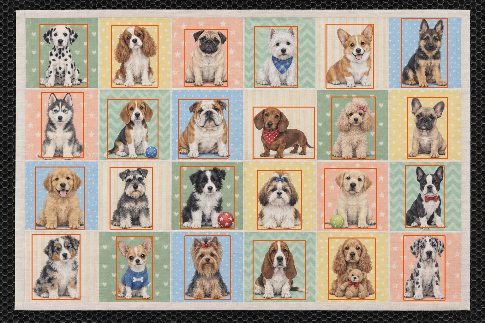
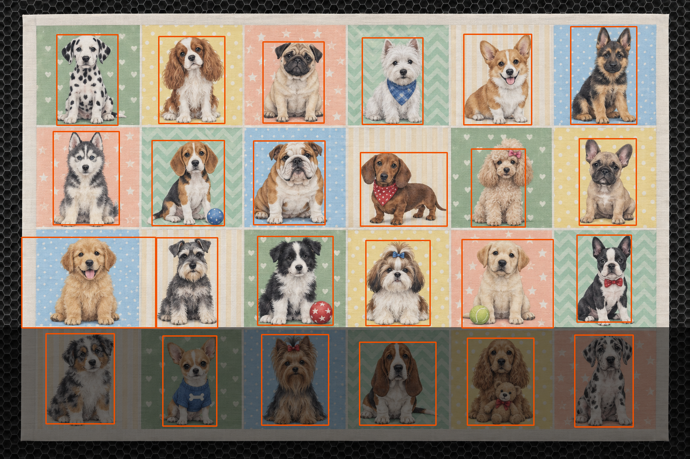
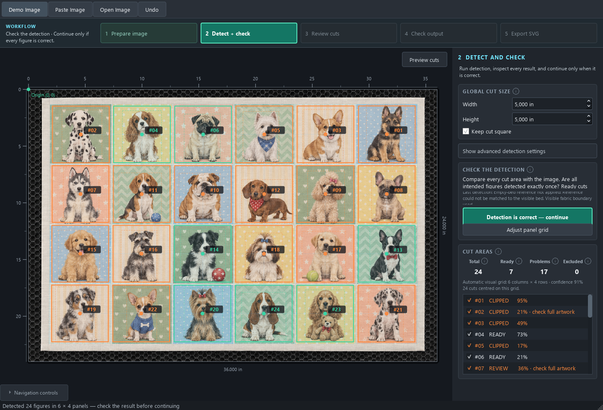

# Primera implementación del análisis adaptativo

22 de septiembre de 2026. Revisión del detector:
`2026-09-22-adaptive-plan`. Activada por defecto al detectar; no requiere pasos
nuevos en la interfaz ni dependencias adicionales. Usa CPU, OpenCV y NumPy.

## Cambios efectivos

- Perfil global reducido antes de recortar el análisis. El original se conserva.
- Propuestas de paneles, repetición, distribución regular y cámara comparadas con
  las mismas medidas de divisiones, ocupación, alineación y candidatos exteriores.
  Las puntuaciones de cada productor no se comparan como probabilidades.
- Medidas por casilla: paleta de fondo con varios colores, fiabilidad, contraste,
  detalle fino y semejanza con otras casillas. Se ejecuta segmentación local cuando
  el fondo tiene apoyo suficiente y contraste local en caso contrario.
- Semillas de fondo seguro dentro de la casilla propietaria, en vez de exigir que
  el borde exterior del contexto tenga su mismo color. El contexto sigue siendo
  revisable. Los componentes locales no se eliminan como si fueran bordes de cama.
- Limpieza reducida cuando hay detalle fino. Segmentación local limitada a un lado
  máximo de 320 píxeles; perfil global a 960. Son límites internos registrados.
- Vista alternativa para bandas oscuras con apoyo cromático/luminoso entre franjas;
  ganancia máxima 1,6. Puede recuperar soporte que la máscara de tela brillante
  había perdido. El original sigue siendo la fuente de revisión de extensión.
- Revisión de extensión sobre la casilla completa y contexto, utilizando varios
  colores de fondo. Una cabeza pequeña ya no limita la ventana para buscar patas.
- Diagnósticos JSON con perfil, política, hipótesis, planes locales y compensación
  utilizada. Los centros del grid y la escala física no se desplazan para hacer
  caber una detección parcial.

La similitud entre fondos se registra y se usa para respaldar hipótesis locales
de iluminación. Esta versión todavía no comparte una paleta aprendida entre todas
las casillas: cada segmentación conserva muestras de su propia zona. La ruta de
composiciones repetidas mantiene su extracción de dibujos completos y registra el
perfil de zonas, evitando dividir automáticamente motivos entre dos casillas.

## Resultados reproducibles

`evaluation.json` contiene 11 imágenes originales de evaluación y cuatro variantes
de sombra. Las variantes no son colecciones nuevas independientes. Las imágenes
generadas fueron utilizadas durante el desarrollo; estos números no son una tasa
de acierto general sobre colecciones desconocidas.

| Imagen | Composiciones esperadas | Antes | Ahora | Revisiones de extensión/layout antes → ahora |
| --- | ---: | ---: | ---: | ---: |
| Floral generado | 24 | 24 | 24 | 2 → 4 |
| Animales pastel generado | 24 | 24 | 24 | 14 → 9 |
| Perros rectos | 24 | 24 | 24 | 15 → 4 |
| Corazones rectos | 24 | 24 | 24 | 9 → 0 |
| Pastel recto | 24 | 24 | 24 | 5 → 0 |
| Transporte generado con jirafa | 19 | 19 | 19 | 6 → 1 |
| Pastel cámara | 24 | 24 | 24 | 19 → 2 |
| Patchwork cámara tenue | 24 | 22 | 22 | 13 → 7 |
| Transporte cámara con jirafa | 19 | 19 | 19 | 2 → 2 |
| Vehículos | 24 | 24 | 24 | 2 → 1 |
| Floral recuperado del historial | 24 | 24 | 24 | 4 → 0 |

Los avisos no son errores de detección medidos: pueden ser advertencias legítimas
o falsas alarmas. Su disminución por sí sola no demuestra mayor exactitud.
El ensayo anterior del floral recuperado está en `../image-audit/`.

En perros, los nueve puntos de cuerpo/patas anotados en el diagnóstico anterior
quedaban fuera de las cajas detectadas. Ahora los nueve están dentro de las cajas
de sus composiciones correspondientes. Se conserva este resultado con las cuatro
variantes de sombra. Es una comprobación parcial de cajas, no una anotación de
todos los píxeles de las siluetas.



Sombras añadidas a la parte inferior del mismo panel:

| Variante | Resultado actual |
| --- | --- |
| Sombra dura, luminosidad ×0,85 | 24 composiciones, grid 6×4 |
| Sombra dura, luminosidad ×0,65 | 24 composiciones, grid 6×4 |
| Sombra dura, luminosidad ×0,45 | 24 composiciones, grid 6×4 |
| Sombra gradual hasta ×0,45 | 24 composiciones, grid 6×4 |

Durante la integración, antes de corregir la iluminación global, las sombras
×0,65 y ×0,45 provocaban 18 composiciones y grid 6×3. Los casos más oscuros ya no
pierden la cuarta fila. Los cortes afectados por compensación conservan aviso de
revisión. Un control con franja impresa azul oscura no activa la compensación.



## Interfaz y tamaño de corte

Se renderizaron y revisaron las tres pruebas rectas en la interfaz, con cuadrados
de 5 pulgadas y cama de 36×24. Resultados en `ui/ui-results.json`:

| Caso | Cortes | Listos | Problemas |
| --- | ---: | ---: | ---: |
| Pastel recto | 24 | 21 | 3 |
| Perros rectos | 24 | 7 | 17 |
| Corazones rectos | 24 | 22 | 2 |

Esta tabla incluye encaje del dibujo en el cuadrado, además de las revisiones de
extensión. No equivale a la tabla anterior. Recuperar más cuerpo del perro puede
revelar que el cuadrado de 5 pulgadas no lo contiene. También puede persistir
contaminación de fondo en algunas cajas: el color verde no constituye una prueba
semántica de dibujo completo. No se ajustó el tamaño del corte para mejorar la
tabla. Las imágenes sintéticas no proporcionan calibración física real.



## Coste y validación

- **176 pruebas correctas**, 107,1 segundos en la ejecución completa guardada en
  `validation.txt`. Incluyen regresiones previas, interfaz y diez pruebas
  nuevas del análisis adaptativo.
- En las diez imágenes comunes, mediana orientativa del detector: **1,74 s antes
  y 3,02 s ahora**. Ejecuciones locales únicas, sin repetir para seleccionar el
  mejor tiempo; no son un benchmark estadístico ni del ordenador del cliente.
- Rango observado de las once imágenes: aproximadamente **1,0–3,7 s**.
- Pico del proceso de evaluación: **292 MiB de memoria residente**, incluyendo
  Python, OpenCV y las imágenes de la evaluación; excluye la interfaz Qt. No es
  el incremento de memoria causado únicamente por el planificador.
- No se descargaron modelos ni se añadieron dependencias. La planificación sí
  añade cálculo; no se presenta como una mejora gratuita de rendimiento.

Comandos desde la raíz:

```powershell
.venv/Scripts/python.exe -m unittest discover -s tests -q
.venv/Scripts/python.exe -m tests.evaluate_adaptive_planning
.venv/Scripts/python.exe -m tests.evaluate_global_detection --output docs/qa/adaptive-planning/ui --screenshots
```

## Límites pendientes

1. Patchwork muy tenue: quedan dos composiciones sin segmentación confirmada.
2. No hay máscaras completas anotadas para todas las colecciones. Las cajas pueden
   omitir detalles o incluir fondo pese a tener el recuento correcto.
3. La compensación global actual trata bandas horizontales respaldadas por varias
   franjas. No demuestra cobertura de cualquier sombra diagonal, vertical,
   localizada, coloreada o con información perdida por oscuridad extrema.
4. Tinta gris oscura uniforme y sombra pueden ser ambiguas sin otras referencias.
   El cambio de color sirve como control negativo, no como garantía universal.
5. La vista compensada ayuda a proponer geometría y se revisa sobre el original;
   aún no se ejecutan dos pipelines completos para comparar todas sus siluetas.
6. No todas las fotos originales del cliente están disponibles sin superposiciones;
   las capturas históricas no se utilizaron como fotografías de entrada.

Esta versión entrega una primera implementación medible de la planificación. No
certifica que cualquier colección nueva produzca todos sus cortes correctos.
