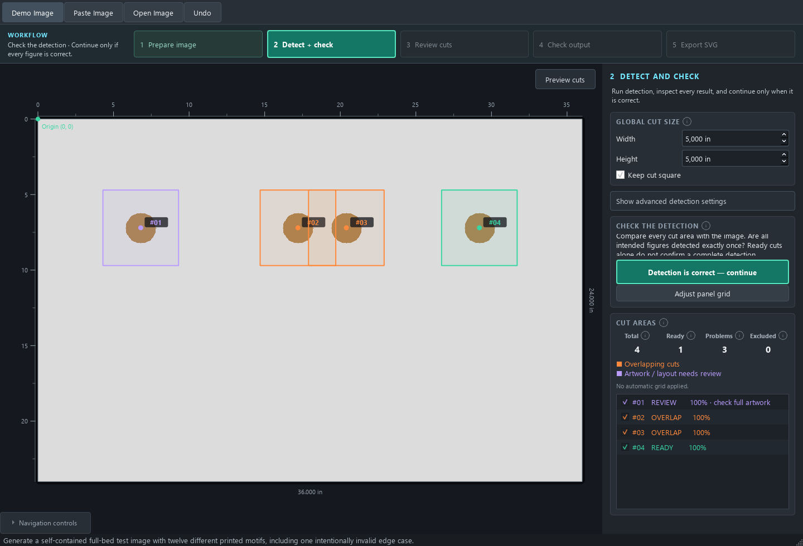

# Colores de revisión y diagnóstico de periodicidades competidoras

22 de septiembre de 2026.

**Actualización posterior:** el usuario aportó el original y se reprodujeron los
12 cortes. El [diagnóstico confirmado y la corrección](../transport-shared/README.md)
recuperan 24 composiciones en 6×4. El texto siguiente conserva la investigación
anterior basada en la captura; su indicación de «selección sin modificar» describe
ese estado anterior, no la revisión actual.

## Cambio de interfaz

Naranja (`#ff8a3d`) se reserva para solapamientos. Violeta (`#ba9cff`) identifica
revisión de extensión, dibujo recortado en un corte de grid o asignación dudosa.
Los cortes de geometría inválida siguen en rojo; listos en verde y excluidos en
gris. Si coexisten solapamiento y revisión de dibujo, prevalece naranja y se
conservan las razones en el detalle. La selección mantiene su resaltado cian.

Canvas y lista usan la misma función `app/ui/cut_status.py`; se añadió leyenda.
Se verificó el render y pasaron las 50 pruebas de diagnósticos/interfaz ejecutadas
con `tests.test_detection_diagnostics_ui` y `tests.test_ui_smoke`.

## Qué muestra la captura del usuario

Se observan 24 ilustraciones en seis columnas y cuatro filas. Los 12 centros de
corte siguen aproximadamente cuatro columnas y tres filas y varios caen entre
dibujos. Es evidencia visual de una distribución global equivocada. No demuestra
qué productor de grid ganó, cuáles fueron sus puntuaciones ni qué ajustes se
usaron. No se ejecutó el detector sobre la captura: sus superposiciones modificarían
la entrada. El original sin superposiciones y el JSON de esa ejecución permitirían
confirmar la ruta exacta.

La tipología combina fondo continuo, estrellas, marcos claros discontinuos,
figuras con distintas proporciones y huecos interiores. Hay varias repeticiones
espaciales que pueden competir. La ausencia de perspectiva no elimina esa
ambigüedad. No hay evidencia suficiente para atribuir esta captura a una sombra.

## Comprobación sin ajustar una colección concreta

`python -m tests.diagnose_grid_typology` produce diez paneles procedurales de
figuras geométricas. Se probaron distribuciones 6×4 y 5×3, cada una con:

- Fondo continuo.
- Estrellas.
- Marcos discontinuos.
- Estrellas y marcos.
- Estrellas, marcos y figuras alternando anchas y estrechas.

Los diez casos recuperan sus dimensiones y recuentos esperados. Por tanto,
«hay líneas discontinuas» no es por sí solo una explicación suficiente.

Una segunda prueba aísla el comparador: suministra 24 centros exactos conocidos,
una propuesta correcta 6×4 y líneas decorativas fuertes a otra periodicidad 4×3.
El comparador elige la propuesta decorativa:

| Evidencia | Decorativa 4×3 | Composiciones 6×4 |
| --- | ---: | ---: |
| Apoyo de líneas | 1,000 | 0,125 |
| Fracción de casillas ocupadas | 1,000 | 1,000 |
| Fracción de centros alineados | 0,333 | 1,000 |
| Puntuación | 0,833 | 0,650 |

Esto reproduce una debilidad del **comparador aislado**, no el fallo completo de
la foto del cliente. El pipeline tiene otra defensa (`contradicts_artwork`) que
puede descartar una propuesta de panel cuando existe una alternativa estable de
dibujos. Si esa alternativa no se produce o la propuesta entra por otra ruta,
esa defensa puede no bastar. Tampoco se ha demostrado que los marcos decorativos
de la captura formen exactamente una periodicidad 4×3.

El defecto general es que «todas las casillas tienen algo» da la misma puntuación
a dos distribuciones aunque una agrupe varios centros. Un apoyo fuerte de líneas
puede compensar una alineación de dibujos peor. La comparación tampoco mide
directamente, en esa función, cuántas composiciones quedan separadas correctamente.

La siguiente corrección del detector debe contrastar las divisiones con centros
independientes y estables a varios umbrales, penalizar casillas con varias
composiciones y comprobar cambios grandes de número/fase del grid. No debe
penalizar indiscriminadamente fragmentos: una mariposa junto a un gato o dos partes
de un mismo dibujo pueden ser una sola composición. Forzar 6×4, bajar un umbral
para coches o escoger siempre el mayor recuento no resuelve el mecanismo.

**En esta revisión se cambia la interfaz y se añade el diagnóstico; no se retoca
la selección del grid basándose en la captura.** Datos completos: `diagnosis.json`.

## Imágenes que conviene generar y probar

Base reutilizable:

> Imagen cenital ortogonal de una tela rectangular completamente plana, sin
> perspectiva, sobre una superficie oscura. Seis columnas y cuatro filas de
> composiciones bien separadas y centradas, 24 composiciones en total. Sin interfaz,
> números, etiquetas ni cuadrados de detección. Deja visible todo el borde de la
> tela y un margen exterior. Mantén todos los dibujos completos.

Añadir una variante cada vez; el número solicitado al generador debe verificarse
visualmente antes de considerarlo una referencia correcta.

| Prioridad | Variante para añadir al prompt | Qué comprobar |
| --- | --- | --- |
| 1 | Fondo azul continuo con estrellas claras; marcos discontinuos blancos; motivos de objetos marinos alternando formas altas y anchas | Si el grid sigue a las composiciones o a los marcos |
| 2 | 24 motivos en 6×4 y una decoración de fondo con bandas a otra frecuencia, sin coincidir con las filas/columnas de los motivos | Confusión entre repetición decorativa y distribución de dibujos |
| 3 | Animales beige muy claros sobre crema; caras oscuras y patas/colas casi del mismo tono que el fondo | Detecciones de cabeza que omiten cuerpo |
| 4 | Fondos distintos por casilla, muy estampados; misma escala y separación de motivos | Aprovechar divisiones sin incluir todo el estampado como dibujo |
| 5 | Pájaros con patas finas, ramas y hojas; mariposas con antenas; letras con trazos finos | Pérdida de detalles por limpieza y agrupación |
| 6 | Cada composición incluye un objeto principal y un accesorio pequeño separado, dentro de su casilla; algunas figuras con huecos grandes como bicicletas | Fragmentación, accesorios convertidos en cortes o eliminados |
| 7 | Una sombra diagonal y otra versión con una franja de sombra vertical, conservando dibujos visibles | Casos no cubiertos por la compensación horizontal actual |
| 8 | Banda de fondo impresa gris oscuro, sin sombra real; otra versión equivalente con sombra real | Falsa interpretación de tinta oscura como iluminación |
| 9 | Dos casillas realmente vacías; otra imagen con dos dibujos muy tenues en esas posiciones | Diferenciar ausencia real y evidencia débil; no inventar cortes confirmados |
| 10 | Repetir una variante en 5×3 y 7×4; otra con un único dibujo alto ocupando dos posiciones | Dependencia de 6×4 y composiciones que abarcan varias casillas |

Para comparar, anotar recuento, filas/columnas, posición de centros y partes del
dibujo que quedan fuera. Conservar imagen sin superposiciones, captura del
resultado y diagnóstico JSON. No valorar únicamente el número de cuadros verdes.
