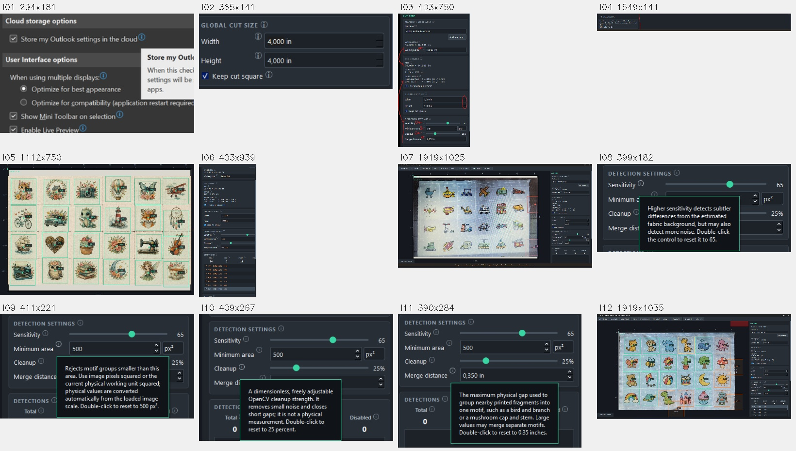
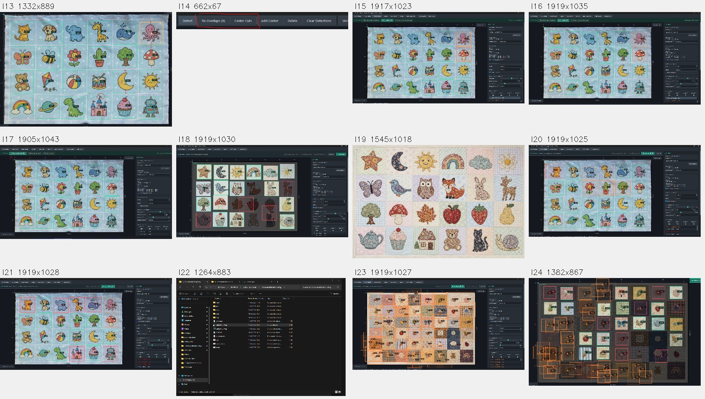
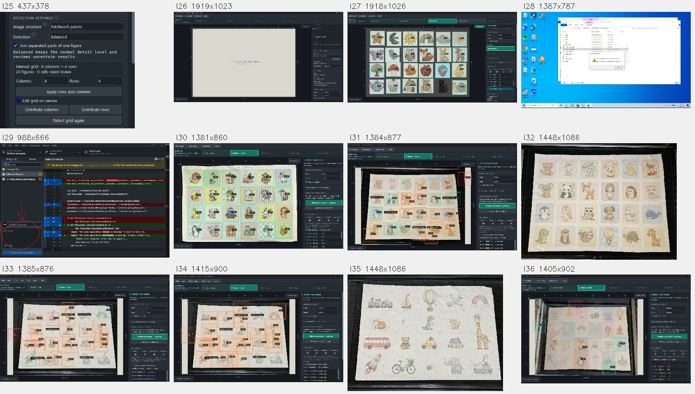
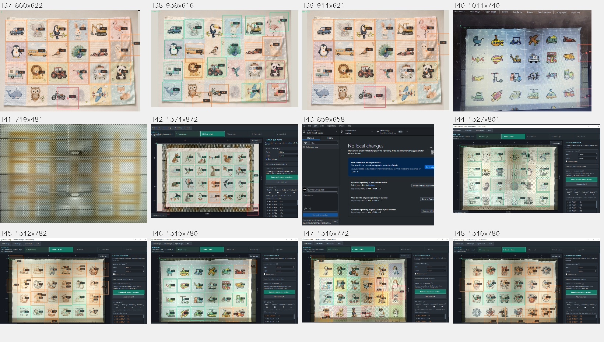
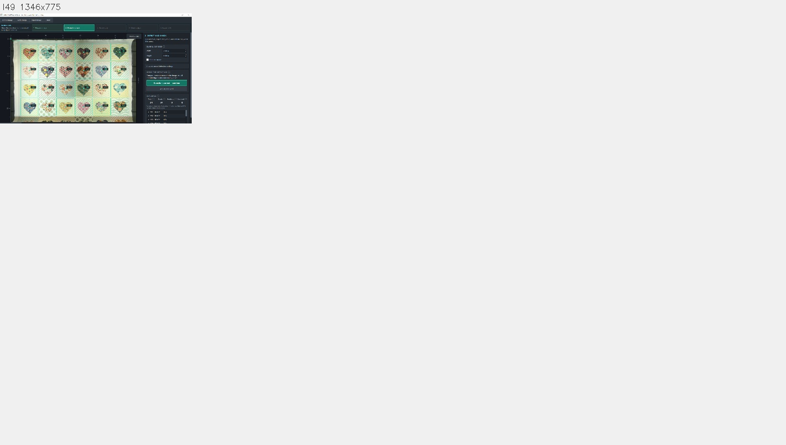
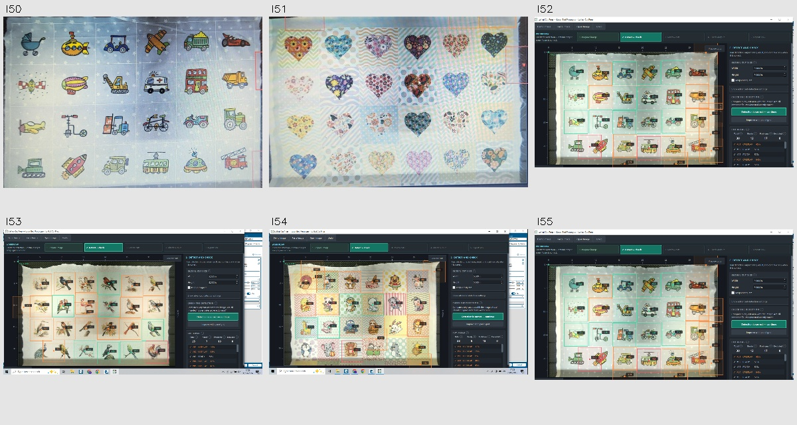

# Revisión de imágenes de conversaciones del proyecto

21 de septiembre de 2026. Se recuperaron 55 imágenes distintas por SHA-256 de
conversaciones accesibles del proyecto. Hay repeticiones visuales con bytes
distintos, controles de interfaz y capturas de errores. **No son 55 colecciones.**

Se consultaron «Crear demo local Epilog», «Diagnostica detección de dibujos»,
«Corrige centrado y atajos», «Explicar detección de imágenes», «Analiza el flujo y
la interfaz», «Revisar error de instalación», «Mejorar detección con grid global»,
«Analiza fallos de detección», «Genera imagen con otra tela» y «Problema de
detección». Se recuperaron adjuntos de historiales locales cuando sus rutas
temporales originales ya no existían. Esto no garantiza acceso a conversaciones
externas, eliminadas o no asociadas a este proyecto.

`inventory.json` guarda identificador, hash, dimensiones y procedencia. Las rutas
`tmp/project-image-audit` son copias locales auxiliares, excluidas de Git. Las
siguientes hojas de contacto conservan una referencia visual en documentación.
Los IDs I01–I49 siguen la recuperación inicial; I50–I55 son recuperaciones
posteriores y no implican orden cronológico global.

## Qué se usa para qué

- Las capturas históricas permiten identificar casuísticas, no volver a medir
  detección sobre sus líneas de colores o etiquetas.
- I50/I51 son fotografías de pantalla: contienen trama de pantalla y restos de
  superposiciones. No deben etiquetarse como originales limpios de cámara.
- I23/I24 muestran patchwork denso de dimensiones distintas de 6×4. El tamaño
  físico seleccionado para cortar también puede causar colisiones aunque la
  detección de posiciones mejore.
- I19 es una imagen sin interfaz ni detecciones superpuestas, conservada sin
  modificación en `tests/fixtures/floral_patchwork_recovered.png`. Su origen
  fotográfico o sintético no se certifica; fue proporcionada en la conversación.
- I41 muestra cama vacía: es referencia de soporte, no una colección de dibujos.
- Las seis imágenes generadas ya guardadas en `tests/fixtures/generated` tienen
  su propia procedencia y complementan estos casos; no se cuentan entre las 55.

El nuevo ensayo de I19 conserva los ajustes predeterminados del detector y genera
24 candidatos / grid 6×4 / cuatro revisiones de extensión o layout. El recuento
visual esperado es 24. **No se anotaron todavía siluetas completas ni se midió
precisión de contorno.** Datos en `recovered-floral-baseline.json`.

El plan que relaciona estas imágenes con las decisiones del programa está en
[ADAPTIVE_DETECTION_IMPLEMENTATION_PLAN.md](../../ADAPTIVE_DETECTION_IMPLEMENTATION_PLAN.md).
