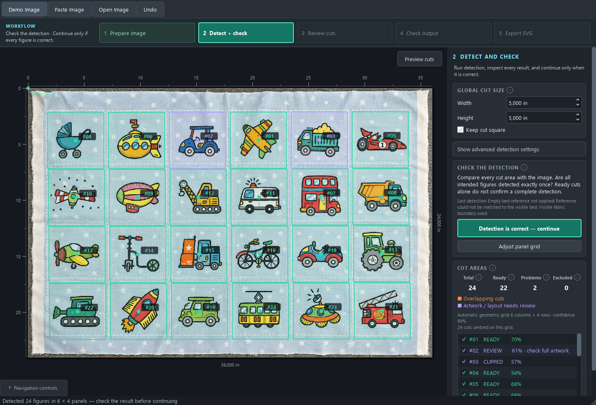

# Corrección reproducida sobre el original de transportes

22 de septiembre de 2026. Detector `2026-09-22-stable-artwork-grid`.

La imagen original aportada por el usuario se conserva sin modificar en
`tests/fixtures/transport_dashed_shared.png`. Contiene 24 composiciones en 6×4,
fondo azul compartido, estrellas y marcos blancos discontinuos. No se utilizan
dimensiones esperadas ni nombre de archivo como entradas del detector.

## Causa confirmada

1. La detección global inicial **ya encontraba los 24 vehículos**.
2. Sus centros permitían ajustar una distribución 6×4 con confianza heurística
   aproximada 0,992, estable al variar la sensibilidad a 55, 65 y 75.
3. Esa distribución no llegaba al selector. El comprobador de casillas regulares
   usado antes dividía el tamaño completo de imagen en casillas, ancladas al borde
   de cámara. En el 6×4 su error mediano normalizado era 0,3018, por encima del
   límite 0,26. Los márgenes y el origen real del estampado no encajaban con esa
   suposición. El ajuste geométrico más flexible existía, pero se aplicaba demasiado
   tarde para impedir la sustitución por el grid de cámara.
4. La ruta alternativa de regiones repetidas tampoco aportaba propuesta en esta
   imagen. Quedaba una propuesta de cámara **4×3**, que generaba los 12 cortes y
   desplazamientos observados. Solo alineaba aproximadamente el 21 % de centros
   iniciales y asignaba de forma única la mitad, pero llenaba sus 12 casillas.

Esto confirma el fallo de selección global. No era una incapacidad para reconocer
vehículos concretos. Los patrones y marcos ofrecen señales competidoras, pero no
se ha aislado qué detalle individual originó cada hipótesis de cámara. El fallo
relevante era aceptar esa hipótesis sin contrastarla con el 6×4 ya sustentado por
los dibujos.

## Corrección general

- Proponer también la cuadrícula ajustada a los centros de dibujos, con su origen
  y separación propios, independientemente del tamaño de foto y márgenes.
- Exigir concordancia de dimensiones, separación y posición entre tres umbrales.
  El pase principal y al menos otro deben explicar limpiamente la mayoría de
  candidatos; un pase permisivo puede añadir fragmentos si no altera el ajuste.
- Contrastar todas las propuestas con esa evidencia estable, incluidas las de
  cámara. Una alternativa que agrupa muchos centros y los alinea peor no puede
  ganar solo por sus líneas o por tener todas sus casillas ocupadas.
- Conservar las composiciones completas de la detección global si gana esa ruta.
  No volver a segmentarlas dentro de una cuadrícula más gruesa.

No se cambian umbrales por colección ni se fuerza 6×4. Las pruebas incluyen
distribuciones 4×3, 7×4 y 3×5, geometría inestable que debe rechazarse y la prueba
de decoraciones fuertes frente a centros independientes.

## Resultado

| Comprobación | Antes | Después |
| --- | ---: | ---: |
| Original: composiciones | 12 | 24 |
| Original: grid | 4×3 | 6×4 |
| Original: ruta seleccionada | cámara | centros de dibujos estables |
| Original con 80 px de margen oscuro | 12 durante la integración | 24, grid 6×4 |
| Original al 50 % de resolución | — | 24, grid 6×4 |

En la interfaz, con cuadrados de 5 pulgadas: **24 cortes, cero solapamientos,
22 listos y dos avisos violetas**. Un aviso es de extensión del dibujo del tractor
superior; el otro indica encaje de la caja detectada del camión verde en el corte.
No se modificó el tamaño físico ni se suprimieron esos avisos. La corrección del
grid no certifica por sí sola todos los contornos.

Datos: `before.json`, `after.json`, `after-ui.json`, `framing-probes.json` y
`ranking-after.json`. La comparación de otras telas está en `all-fixtures/`.
El diagnóstico aislado anterior de periodicidades competidoras ahora selecciona
la distribución de composiciones en vez de la decorativa.

Pruebas: **182 correctas** en la suite completa, incluidas cinco regresiones de
`tests.test_stable_artwork_grid`; resultado final en `validation.txt`. Las diez
telas anteriores conservan sus recuentos. La captura histórica y la imagen original no se confunden: la
reproducción se realizó sobre el PNG original sin cuadrados de detección.
